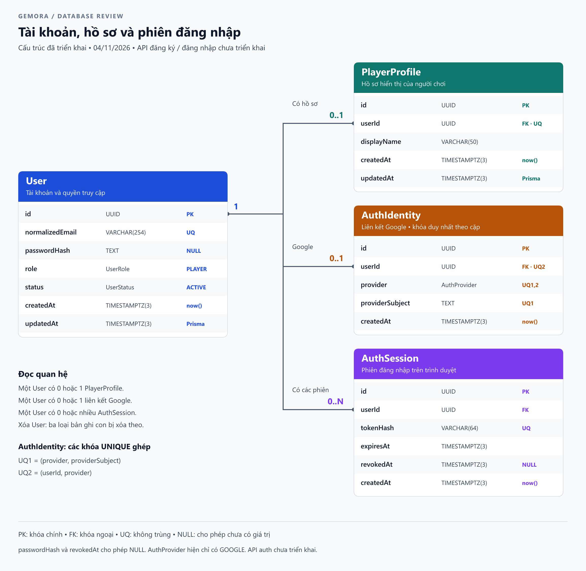

# Database Gemora — bản hiện tại để xem xét

> Kiểm tra hiện trạng mới nhất ngày 08/11/2026: [database trước khi nối UI](DATABASE_AUDIT_2026-11-08.md). API auth đã được triển khai; các câu bên dưới nói auth “chưa có” phản ánh thời điểm tài liệu cũ, không phải trạng thái hiện tại.

Ngày: 04/11/2026. Nguồn: [schema.prisma](../apps/game-server/prisma/schema.prisma) và [migration đầu tiên](../apps/game-server/prisma/migrations/20261102000100_init_auth/migration.sql).

Đây là sơ đồ của **cấu trúc đã triển khai cho phần tài khoản**, không phải thiết kế toàn bộ game. Bốn bảng hỗ trợ lưu tài khoản local, Google và phiên. Backend hiện chưa có API đăng ký, đăng nhập hoặc xử lý phiên; có bảng không đồng nghĩa các hành vi này đã hoạt động.

Cập nhật 04/11/2026: [migration Google](../apps/game-server/prisma/migrations/20261104000100_add_google_identity/migration.sql) đã thêm AuthIdentity và cho phép passwordHash NULL, giữ nguyên các dữ liệu đã có.

[Mở sơ đồ lớn](diagrams/index.html) · [SVG](diagrams/auth-database.svg) · [PNG](diagrams/auth-database.png)

## 1. Đọc sơ đồ

| Ký hiệu | Giải thích |
|---|---|
| Bảng | Nơi chứa nhiều bản ghi cùng loại; ví dụ User chứa các tài khoản |
| Dòng / bản ghi | Một đối tượng cụ thể, ví dụ tài khoản của bạn |
| Cột / trường | Một thông tin của đối tượng, ví dụ email; trong tài liệu này hai từ có cùng nghĩa |
| PK — Primary Key | Khóa chính: định danh duy nhất, không được để NULL |
| FK — Foreign Key | Khóa ngoại: giá trị phải trỏ đến một bản ghi tồn tại ở bảng cha |
| UQ — Unique | Giá trị không được trùng giữa các bản ghi |
| NULL | Chưa có giá trị; khác chuỗi rỗng và khác số 0 |
| 1 / 0..1 / 0..N | Chính xác một / không có hoặc một / không có hoặc nhiều |
| Index | Cấu trúc giúp tra cứu nhanh; không tự tạo quan hệ hay bảo đảm duy nhất nếu không có UNIQUE |

## 2. Mối quan hệ

### User và PlayerProfile: một tài khoản có tối đa một hồ sơ

`PlayerProfile.userId` tham chiếu `User.id`. Cột userId vừa NOT NULL vừa UNIQUE:

- Mỗi PlayerProfile bắt buộc thuộc đúng một User tồn tại.
- Một User có thể có **0 hoặc 1** PlayerProfile. Database chưa bắt buộc mọi User phải có hồ sơ.
- Khi viết đăng ký, backend sẽ tạo User và PlayerProfile trong cùng transaction để một trong hai thất bại thì hủy cả hai.
- Không cần đặt thêm profileId trong User: userId ở PlayerProfile đã mô tả quan hệ.

Ví dụ: User có id A và PlayerProfile có userId A là tài khoản và hồ sơ của cùng một người. Không thể tạo hồ sơ thứ hai có userId A.

### User và AuthSession: một tài khoản có nhiều phiên đăng nhập

`AuthSession.userId` tham chiếu `User.id`; cột này không UNIQUE:

- Một User có thể chưa có phiên nào hoặc có nhiều phiên.
- Mỗi AuthSession bắt buộc thuộc đúng một User tồn tại.
- Khi triển khai, đăng nhập trên máy 1 và máy 2 có thể tạo hai phiên cùng userId. Mỗi trình duyệt/lần đăng nhập có thể có phiên riêng; phiên không định danh duy nhất một máy vật lý.
- Đăng xuất phiên trên máy 1 sẽ thu hồi phiên đó; phiên trên máy 2 vẫn có thể dùng tiếp.

PlayerProfile và AuthSession không liên kết trực tiếp; chúng cùng tham chiếu User. Không cần thêm một khóa ngoại giữa hai bảng này.

### Khi xóa tài khoản

Các khóa ngoại có `ON DELETE CASCADE`: xóa cứng một User sẽ xóa hồ sơ, toàn bộ phiên và các AuthIdentity của tài khoản đó. `ON UPDATE CASCADE` cập nhật khóa ngoại nếu id cha thay đổi, dù ứng dụng bình thường không nên đổi id.

Đổi status sang LOCKED **không xóa** hồ sơ hoặc phiên và database không tự chặn đăng nhập. Backend phải kiểm tra trạng thái tài khoản khi xác thực yêu cầu.

## 3. User — tài khoản và quyền truy cập

| Cột | Kiểu PostgreSQL | Ràng buộc / mặc định | Ý nghĩa |
|---|---|---|---|
| id | UUID | PK, NOT NULL | Mã tài khoản. Prisma sinh UUID khi tạo qua Prisma Client; migration không đặt hàm sinh UUID mặc định trong PostgreSQL. Nếu INSERT SQL trực tiếp phải cung cấp id. |
| normalizedEmail | VARCHAR(254) | UQ, NOT NULL | Email đã chuẩn hóa để dùng đăng nhập. Backend sẽ trim và chuyển chữ thường trước khi lưu/tìm. Hiện database chỉ chặn giá trị trùng chính xác, chưa tự chuẩn hóa hay kiểm tra định dạng email. |
| passwordHash | TEXT | Cho phép NULL | Chuỗi băm mật khẩu Gemora; NULL khi chỉ dùng Google. Khi có mật khẩu, API phải băm bằng Argon2id trước khi ghi; cột không tự băm. Không dùng mật khẩu giả cho tài khoản Google. |
| role | UserRole (enum) | NOT NULL, PLAYER | Quyền: PLAYER = người chơi, ADMIN = quản trị. Client không được tự chọn ADMIN khi đăng ký; backend phải kiểm tra quyền ở API quản trị. |
| status | UserStatus (enum) | NOT NULL, ACTIVE | ACTIVE = được hoạt động; LOCKED = bị khóa. Đây là trạng thái tài khoản, không phải trạng thái đang online. |
| createdAt | TIMESTAMPTZ(3) | NOT NULL, CURRENT_TIMESTAMP | Thời điểm tạo; PostgreSQL cấp mặc định nếu không truyền. Độ chính xác mili giây. |
| updatedAt | TIMESTAMPTZ(3) | NOT NULL, Prisma @updatedAt | Thời điểm cập nhật. Prisma tự quản lý khi ghi qua Client; không phải trigger PostgreSQL. Sửa bằng SQL/pgAdmin phải chủ động cập nhật trường này. |

UserRole và UserStatus là kiểu enum (danh sách giá trị được phép), không phải hai bảng riêng. Thời gian lưu dưới dạng thời điểm có xử lý múi giờ; khi hiển thị có thể đổi sang giờ Việt Nam.

## 4. PlayerProfile — thông tin hiển thị của người chơi

| Cột | Kiểu PostgreSQL | Ràng buộc / mặc định | Ý nghĩa |
|---|---|---|---|
| id | UUID | PK, NOT NULL; Prisma sinh UUID | Mã hồ sơ, độc lập với mã tài khoản |
| userId | UUID | FK tới User.id, UQ, NOT NULL | Cho biết hồ sơ thuộc tài khoản nào; UNIQUE giới hạn một hồ sơ mỗi tài khoản |
| displayName | VARCHAR(50) | NOT NULL, không UNIQUE | Tên hiển thị trong game. Có thể trùng giữa người chơi; hiện DB chỉ giới hạn tối đa 50 ký tự, chưa chặn chuỗi rỗng hoặc chỉ có khoảng trắng. |
| createdAt | TIMESTAMPTZ(3) | NOT NULL, CURRENT_TIMESTAMP | Thời điểm tạo hồ sơ |
| updatedAt | TIMESTAMPTZ(3) | NOT NULL, Prisma @updatedAt | Thời điểm hồ sơ thay đổi qua Prisma; SQL trực tiếp phải tự xử lý |

Tách hồ sơ khỏi tài khoản giúp phần giao diện/gameplay phát triển độc lập với mật khẩu và quyền. Bảng hiện chưa có level, gold, avatar hoặc hero; các trường này sẽ được thiết kế khi đến phần gameplay.

## 5. AuthSession — phiên đăng nhập

| Cột | Kiểu PostgreSQL | Ràng buộc / mặc định | Ý nghĩa |
|---|---|---|---|
| id | UUID | PK, NOT NULL; Prisma sinh UUID | Mã bản ghi phiên. Không đồng nghĩa với token bí mật gửi cho trình duyệt. |
| userId | UUID | FK tới User.id, NOT NULL, có index | Tài khoản sở hữu phiên; dùng để tìm hoặc thu hồi các phiên của một người |
| tokenHash | VARCHAR(64) | UQ, NOT NULL | Bản băm của token ngẫu nhiên; thiết kế dự kiến dùng SHA-256 dạng hex 64 ký tự. Token gốc đặt trong cookie HttpOnly khi API auth được triển khai. DB chỉ giới hạn tối đa 64 ký tự, chưa kiểm tra chuỗi hex hoặc băm đúng. |
| expiresAt | TIMESTAMPTZ(3) | NOT NULL, có index | Thời điểm hết hạn do backend tính lúc tạo phiên. Database không tự xóa bản ghi khi đến thời điểm này. |
| revokedAt | TIMESTAMPTZ(3) | Cho phép NULL | NULL = chưa ghi nhận thu hồi; có thời gian = đã thu hồi, ví dụ khi đăng xuất. NULL không đồng nghĩa phiên còn hạn. |
| createdAt | TIMESTAMPTZ(3) | NOT NULL, CURRENT_TIMESTAMP | Thời điểm tạo phiên |

Khi triển khai, một phiên chỉ hợp lệ khi token khớp, `revokedAt IS NULL`, `expiresAt` còn ở tương lai và User có status ACTIVE. Đây là logic backend phải bổ sung, không phải tính năng database đã tự cung cấp.

passwordHash và tokenHash có mục đích khác nhau: mật khẩu do người dùng chọn cần thuật toán băm mật khẩu chậm; token phiên là dữ liệu ngẫu nhiên đủ mạnh, có thể dùng SHA-256 để tra cứu. Không trả hai trường hash này trong API hồ sơ.

Hai index bổ sung trên AuthSession: userId giúp tìm phiên theo tài khoản; expiresAt giúp tìm các phiên hết hạn để dọn. PK và UQ cũng đã có index tương ứng, không cần tạo index trùng cho chúng.

## 5a. AuthIdentity — phương thức đăng nhập Google

| Cột | Kiểu / ràng buộc | Ý nghĩa |
|---|---|---|
| id | UUID, PK, NOT NULL | Mã liên kết; Prisma sinh UUID |
| userId | UUID, FK tới User.id, NOT NULL | Tài khoản Gemora sở hữu liên kết |
| provider | AuthProvider, NOT NULL | Nhà cung cấp xác thực; enum hiện chỉ có GOOGLE, không đặt mặc định ngầm |
| providerSubject | TEXT, NOT NULL | Định danh sub do Google xác nhận, không phải email hoặc token |
| createdAt | TIMESTAMPTZ(3), NOT NULL, default now() | Thời điểm liên kết |

Unique(provider, providerSubject) ngăn một Google thuộc hai User. Unique(userId, provider) giới hạn một Google mỗi User; các cột riêng lẻ không có UNIQUE. Vì hiện chỉ hỗ trợ GOOGLE, User có 0..1 AuthIdentity. Nếu bổ sung provider khác sau này, User có thể có một identity cho mỗi provider.

AuthIdentity cũng có ON DELETE CASCADE và ON UPDATE CASCADE: xóa User sẽ xóa cả liên kết Google. Tài khoản local chưa liên kết có 0 identity; Google-only có passwordHash NULL và một identity; tài khoản dùng cả hai có passwordHash và identity. Backend phải tạo Google-only User/Profile/Identity trong cùng transaction và không cho tồn tại tài khoản không có phương thức đăng nhập; FK không tự bảo đảm invariant xuyên bảng này.

Không tự liên kết vì email trùng. Backend phải xác minh danh tính và quyền sở hữu trước khi ghi AuthIdentity. Bảng không lưu mật khẩu Google hoặc Google access/refresh token.

## 6. Các trường chỉ tồn tại trong Prisma

`User.profile`, `User.sessions`, `User.identities`, `PlayerProfile.user`, `AuthSession.user`, `AuthIdentity.user` là các trường quan hệ để Prisma hỗ trợ truy vấn. **Chúng không phải cột vật lý trong PostgreSQL**, nên sơ đồ không vẽ thêm cột cho các trường này.

## 7. Bảng _prisma_migrations trong pgAdmin

Đây là bảng nội bộ quản lý migration, đứng riêng và không có khóa ngoại đến bốn bảng nghiệp vụ. Không dùng nó để lưu dữ liệu người chơi và không chỉnh thủ công trong luồng làm việc thông thường.

| Cột | Ý nghĩa |
|---|---|
| id | Mã lần thực thi migration |
| checksum | Dấu kiểm tra nội dung file migration để phát hiện file bị thay đổi |
| migration_name | Tên migration, ví dụ 20261102000100_init_auth |
| started_at | Thời điểm bắt đầu |
| finished_at | Thời điểm hoàn tất; có thể NULL nếu chưa hoàn tất/thất bại |
| rolled_back_at | Thời điểm đánh dấu rollback khi xử lý lịch sử migration; không có nghĩa dữ liệu đã tự động được hoàn tác |
| logs | Thông tin lỗi/chẩn đoán khi cần |
| applied_steps_count | Bộ đếm bước đã áp dụng do Prisma quản lý |

`gemora_app` bạn tạo trong pgAdmin là **role PostgreSQL dùng kết nối database**, không phải bản ghi trong User, cũng không phải giá trị enum UserRole.

## 8. Những điểm nên đánh giá trước khi viết API auth

| Quyết định | Hiện tại | Đề xuất cho bước tiếp theo |
|---|---|---|
| Tên hiển thị trùng nhau? | Được phép | Giữ nguyên cho MVP; dùng id để định danh. Nếu cần tên đăng nhập công khai duy nhất, thiết kế username riêng. |
| Mỗi tài khoản bắt buộc có hồ sơ? | DB cho phép 0..1 | Tạo User/Profile trong một transaction khi đăng ký. |
| Đăng nhập nhiều thiết bị? | Có thể lưu nhiều phiên | Cho phép; logout chỉ thu hồi phiên hiện tại. Có thể bổ sung logout tất cả sau. |
| Khóa hay xóa tài khoản? | Có LOCKED và hard-delete cascade | Dùng LOCKED khi cần khóa truy cập; quyết định chính sách xóa dữ liệu trước khi thêm gameplay. |
| Chuẩn hóa email? | Chưa tự đảm bảo ở DB | Xử lý nhất quán ở backend và kiểm thử trùng email khác hoa/thường. Nếu nhiều nguồn ghi trực tiếp, cân nhắc constraint/index theo chính sách chuẩn hóa. |
| Thời hạn phiên? | Có expiresAt, chưa có quy tắc cấp phiên | Mốc 7 ngày đang là đề xuất trong kế hoạch; cho phép cấu hình khi viết auth. |
| Kiểm tra nội dung trường? | Chủ yếu type/NOT NULL/UNIQUE/FK | Bổ sung validation tên, email, mật khẩu; kiểm tra thời gian hết hạn hợp lệ. |
| Google? | Đã có AuthIdentity và passwordHash NULL | Cần triển khai xác minh Google và liên kết theo [kế hoạch auth](../tasks/prd-player-auth-email-google.md). Schema/ERD đã cập nhật, API chưa có. |
| Quên mật khẩu / xác minh email? | Chưa có trường hoặc bảng chuyên dụng | Triển khai đợt tiếp theo trước khi phát hành công khai. |

Đánh giá tổng thể: bốn bảng đủ làm nền cho đăng ký/đăng nhập email và Google; cần triển khai các quy tắc xác thực ở backend. Khi sửa cấu trúc sau khi đánh giá, cập nhật schema và tạo migration mới; không sửa migration đã chạy.
