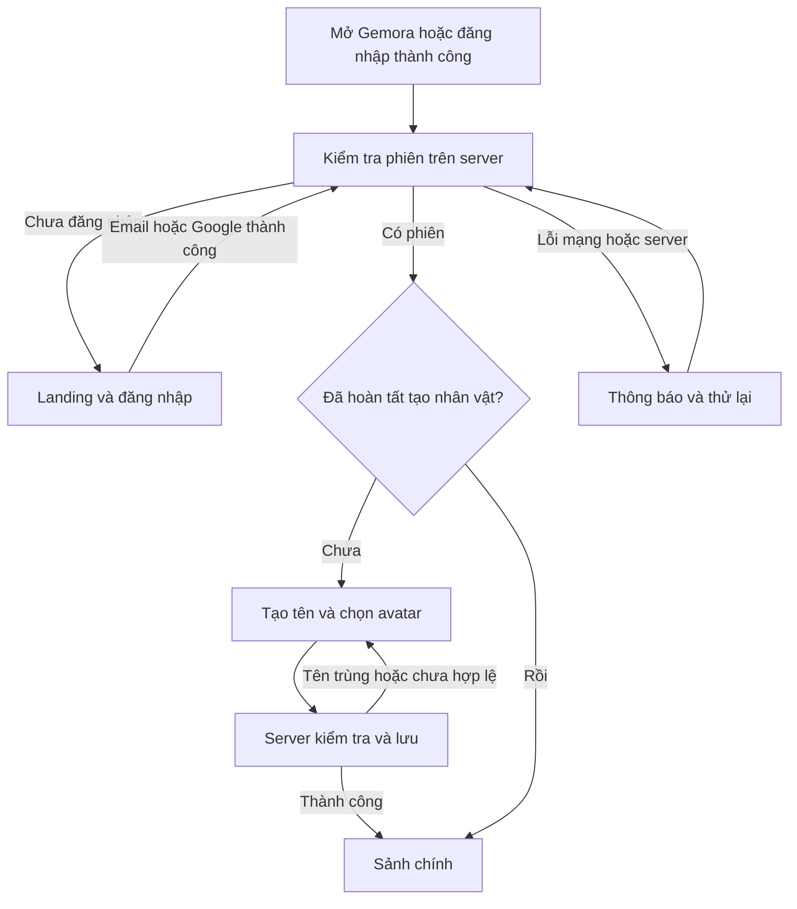

# Kế hoạch tạo nhân vật và sảnh chính — Gemora

> Cập nhật sau khi duyệt UI: xem [kế hoạch nối UI vào luồng thật](UI_FLOW_INTEGRATION_PLAN.md). Tài liệu mới dùng giao diện tiếng Anh hiện có, bổ sung lưu avatar và cập nhật thứ tự triển khai; các mô tả UI ban đầu bên dưới chỉ còn giá trị lịch sử.

Ngày: 08/11/2026. Trạng thái: đề xuất triển khai theo yêu cầu mới; chưa thay đổi mã ứng dụng hoặc database.

## 1. Mục tiêu

Sau khi đăng nhập email hoặc Google thành công:

- Người đã hoàn tất tạo nhân vật đi thẳng vào sảnh chính.
- Người chưa hoàn tất tạo nhân vật vào màn đặt tên; xác nhận thành công mới vào sảnh.
- Người còn phiên khi mở lại website cũng đi qua cùng quyết định này, không phải bấm Play Now rồi đăng nhập lại.
- Sảnh là không gian game fantasy có danh tính người chơi, lối vào PvE/PvP và các chức năng phục vụ chơi game.

Trong Gemora, **nhân vật người chơi** là danh tính của người chỉ huy: tên, avatar, cấp người chơi và tiến trình. **Hero** là các đơn vị trong đội ba người. Đặt tên người chơi không phải chọn tên cho một hero; chọn avatar không quyết định class hay chỉ số chiến đấu.

Đề xuất bản đầu: một nhân vật cho mỗi tài khoản, chưa có màn chọn máy chủ. Đây là quyết định phù hợp mô hình `PlayerProfile.userId` unique hiện có.

## 2. Tham khảo và cách áp dụng

| Nguồn | Điều xác nhận được | Đề xuất cho Gemora |
| --- | --- | --- |
| [Gunny — Tạo nhân vật](https://gunnypc.vnggames.com/gioi-thieu-2020/huong-dan-29/tao-nhan-vat.html) | Người đăng nhập lần đầu/chưa có nhân vật ở máy chủ chọn sẽ tạo nhân vật; chọn giới tính, nhập tên, kiểm tra tên và vào game | Tách đăng nhập khỏi tạo danh tính game; có kiểm tra tên và nút xác nhận vào game. Thay chọn giới tính bằng avatar tùy chọn, phù hợp game đội hero |
| [Gunny — Giao diện game](https://gunny.360game.vn/thuvien/huong-dan-29/giao-dien-game.html) | Sảnh dạng đảo với các khu chức năng; có phòng đấu, ải viễn chinh và menu tiện ích phía dưới | Tạo sảnh fantasy với các lối vào trực quan, giữ thanh chức năng cố định và tên khu rõ ràng |
| [CMN — BangBang Origin chính thức ra mắt](https://game.cmn.vn/tin-tuc/bangbang-origin-chinh-thuc-ra-mat) | Bài giới thiệu của nhà phát hành mô tả giao diện mới và bố trí tính năng/sự kiện dễ nhìn | Ưu tiên nhận ra ngay khu chiến đấu, nhân vật/đội hình và tiện ích; không làm sảnh thành danh sách biểu mẫu |

Giới hạn tham khảo: đây là tài liệu hướng dẫn/bài giới thiệu công khai, không phải kết quả đăng nhập và chơi trực tiếp. Trang CMN chặn đọc trực tiếp tại thời điểm tra cứu; thông tin lấy từ bản được công cụ tìm kiếm lập chỉ mục. BangBang Origin là bản phát triển sau BangBang webgame, không coi giao diện của hai bản hoàn toàn giống nhau. Những bố cục và quy tắc Gemora bên dưới là đề xuất thiết kế riêng, không phải tính năng được khẳng định có trong các game tham khảo. Không lấy nguyên ảnh, icon hoặc nhân vật của game khác.

## 3. Hiện trạng và vấn đề cần giải quyết

- `auth.service.ts` tự tạo `PlayerProfile` khi đăng ký email và khi Google tạo tài khoản mới; Google dùng tên từ nhà cung cấp làm `displayName`.
- `PlayerProfile.displayName` bắt buộc, dài tối đa 50, chưa unique; chưa có dấu mốc hoàn tất tạo nhân vật.
- `AuthUser.profile` có thể null theo hợp đồng nhưng sự tồn tại của profile không chứng minh người dùng đã chủ động chọn tên game.
- Form đăng ký hiện hỏi Display name; sau đăng nhập client vẫn render landing với tên tài khoản và thông báo gameplay đang phát triển.
- GDD §13.1 chưa có màn tạo nhân vật; PRD §8 mô tả Home sau login, còn PvP nằm ở Phase 2.

Vì vậy không dùng lần đăng nhập, ngày tạo tài khoản, cookie, localStorage hoặc `profile != null` để phân loại người chơi mới/cũ. Backend trả trạng thái dựa trên việc hoàn tất tạo nhân vật.

## 4. Luồng và điều hướng



Các đường dẫn đề xuất:

| Đường dẫn | Chưa có phiên | Có phiên, chưa tạo nhân vật | Đã tạo nhân vật |
| --- | --- | --- | --- |
| `/` | Landing | Chuyển `/create-player` | Chuyển `/home` |
| `/create-player` | Yêu cầu đăng nhập | Màn tạo nhân vật | Chuyển `/home` |
| `/home` | Yêu cầu đăng nhập | Chuyển `/create-player` | Sảnh chính |
| `/campaign`, `/team`, `/heroes`, `/inventory` | Yêu cầu đăng nhập | Chuyển `/create-player` | Mở khi tính năng đã triển khai |

Một hàm điều phối dùng chung cho login email, Google callback, restore phiên và quay lại tab. Dùng thay thế lịch sử khi chuyển qua cổng xác thực/tạo nhân vật để Back không quay lại form đã hoàn tất. Khi mất mạng không tự chuyển người chơi sang màn tạo tên. Sử dụng trạng thái loading ổn định trước khi biết trạng thái thật, tránh lóe landing hoặc sảnh sai tài khoản.

Người chơi cũ có trận dở vẫn vào sảnh; sảnh ưu tiên nút **Tiếp tục trận**, không tự ném người chơi vào combat. Tutorial là tiến trình riêng; chưa học xong tutorial không bắt tạo lại tên.

## 5. Màn tạo nhân vật

### Bố cục và nội dung

- Toàn màn hình với nền fantasy của Gemora; trên desktop chia hai vùng: chân dung/biểu tượng và form đặt tên.
- Tiêu đề: **Khởi đầu hành trình**. Mô tả: **Chọn tên mà những người chơi khác sẽ thấy trong Gemora.**
- Avatar: 4–6 lựa chọn có sẵn, một avatar mặc định; không bắt tải ảnh lên hoặc chọn giới tính/class.
- Ô **Tên người chơi**, giải thích ngắn quy tắc ngay bên dưới.
- **Gợi ý tên** cho người chưa nghĩ ra tên; tên gợi ý vẫn phải kiểm tra với server.
- Kiểm tra tên sau khi dừng nhập khoảng 400 ms hoặc rời ô. Hiển thị trạng thái đang kiểm tra/có thể dùng/đã được dùng ngay dưới ô.
- Nút chính **Bắt đầu hành trình**. Nút phụ **Đổi tài khoản** thực hiện logout thật.
- Khi nhấn xác nhận: khóa gửi lặp, giữ dữ liệu nếu lỗi, chỉ vào sảnh sau khi server xác nhận.
- Mobile xếp avatar phía trên form, cho cuộn khi bàn phím mở, giữ nút xác nhận dễ tiếp cận.

### Quy tắc tên đề xuất

| Quy tắc | Giá trị đề xuất |
| --- | --- |
| Độ dài | 3–16 ký tự sau chuẩn hóa NFC; định nghĩa phép đếm thống nhất bằng Unicode code point trong client/server |
| Ký tự được phép | Chữ, dấu kết hợp gắn với chữ, số, khoảng trắng đơn giữa từ và `_`; có tiếng Việt có dấu |
| Chuẩn hóa | Trim, gộp khoảng trắng, NFC; khóa so trùng chuyển chữ thường cùng một thuật toán ở server |
| Tên duy nhất | Toàn game trong bản một nhân vật/tài khoản; không phân biệt hoa/thường, giữ phân biệt dấu tiếng Việt |
| Ký tự bị từ chối | Emoji, ký tự điều khiển/ẩn, markup, dấu kết hợp đứng riêng và ký tự ngoài tập cho phép |
| Tên dành riêng | Danh sách chính xác/có quy tắc rõ cho hệ thống và quản trị; không chỉ kiểm tra bằng UI |
| Đổi tên | Chưa có trong đợt này; giải thích trước khi xác nhận, không ngầm hứa đổi miễn phí |

Ví dụ `Ngọc Lam` và `ngọc lam` là cùng một tên; `Ngoc Lam` là tên khác. Tên hiển thị luôn được render như text. Kiểm tra trước chỉ giúp phản hồi nhanh, không giữ chỗ; khi xác nhận server vẫn kiểm tra lại để tránh hai người cùng lấy một tên.

Form đăng ký email bỏ ô tên hiển thị để không hỏi tên hai lần. Cả email và Google dùng chung màn đặt tên sau khi có phiên. Không tự lấy email/tên Google làm tên nhân vật công khai.

## 6. Sảnh chính

Đề xuất hình thức: **đảo thánh điện pha lê**, trung tâm là đội hero hoặc biểu tượng người chỉ huy; cổng Phiêu lưu và Đấu trường là hai điểm đến lớn. Giữ màu tím/pha lê của landing hiện tại nhưng bổ sung cảnh nền, bố cục không gian và thanh điều khiển của game. Bản đầu dùng HTML/CSS cho HUD và tương tác; PixiJS tiếp tục dành cho gameplay sau.

Phác thảo vị trí, không phải giao diện hoàn thiện:

```text
┌───────────────────────────────────────────────────────────────┐
│ [Avatar] Tên người chơi · Lv.   [Gold]       [Cài đặt][Tài khoản] │
│                                                               │
│ [Mục tiêu tiếp theo]        THÁNH ĐIỆN PHA LÊ                  │
│                        [Đội hình / hero đại diện]              │
│                                                               │
│              [Phiêu lưu PvE]      [Đấu trường PvP]              │
│                [Tiếp tục trận — chỉ khi có trận dở]            │
│                                                               │
│          [Đội hình]      [Anh hùng]      [Túi đồ]                │
└───────────────────────────────────────────────────────────────┘
```

| Vùng | Nội dung và hành vi | Khi chưa có hệ thống liên quan |
| --- | --- | --- |
| Góc trái trên | Avatar, tên nhân vật, cấp người chơi; mở hồ sơ | Tên/avatar dùng dữ liệu thật; ẩn cấp nếu chưa có dữ liệu |
| Thanh tài nguyên | Gold và tài nguyên đang được dùng | Chưa có economy thì ẩn hoặc báo chưa có, không tự bịa số dư |
| Trung tâm | Hero/đội hiện tại hoặc biểu tượng đại diện | Dùng hình minh họa được ghi đúng vai trò, không giả vờ đã sở hữu hero |
| Phiêu lưu PvE | Đi đến campaign, ưu tiên ải tiếp theo | Có thể mở trang giới thiệu trạng thái phát triển; chỉ bật vào trận khi battle API sẵn sàng |
| Đấu trường PvP | Vị trí rõ ràng, đủ chỗ mở phòng/ghép trận sau này | Hiển thị **Sắp mở** và giải thích; không có nút tìm trận giả |
| Mục tiêu tiếp theo | Hướng dẫn đầu tiên hoặc ải tiếp theo theo tiến trình | Có hướng dẫn sảnh ngắn; không hiển thị nhiệm vụ/thưởng chưa tồn tại |
| Thanh dưới | Đội hình, Anh hùng, Túi đồ | Chỉ mở trang có nội dung và chức năng thật; các mục chưa làm hiển thị sắp mở |
| Cài đặt | Âm thanh, giảm hiệu ứng, tùy chọn UI đã có | Không cung cấp công tắc không có tác dụng |
| Tài khoản | Liên kết Google, đăng xuất | Chuyển chức năng đã có từ landing vào đây |

Với người mới, lần vào sảnh đầu chỉ giới thiệu 2–3 điểm: danh tính, Phiêu lưu, Đội hình. Có bỏ qua/xem lại. Khi gameplay đã có thì CTA đưa vào tutorial stage. Không tự thêm daily reward, shop, nạp tiền, guild, chat hoặc chấm thông báo không có dữ liệu.

## 7. Dữ liệu và chuyển tiếp tài khoản hiện tại

### Mở rộng PlayerProfile

| Trường đề xuất | Vai trò |
| --- | --- |
| `playerName: string?` | Tên đã chọn để hiển thị trong game |
| `normalizedPlayerName: string?` | Khóa so trùng, unique tại database |
| `avatarKey: string?` | Khóa trong danh sách avatar được server chấp nhận |
| `onboardingCompletedAt: timestamp?` | Mốc đã hoàn tất tạo nhân vật |

Giữ `displayName` cũ trong giai đoạn chuyển tiếp, không dùng làm nguồn tên trong sảnh. Tài khoản mới có thể giữ giá trị nội bộ mặc định cho trường legacy nếu cần tương thích; không gửi giá trị đó như tên nhân vật đã xác nhận. Khi bỏ trường tên trong đăng ký, backend chấp nhận payload mới không có `displayName`; tạm nhận payload cũ để rollout không làm hỏng client cũ, nhưng không coi đó là hoàn tất nhân vật.

Backend xuất `onboardingState: NEEDS_PROFILE | READY` trong `AuthUser`; đây là trạng thái suy ra từ dữ liệu, không lưu thêm boolean dễ lệch. `READY` yêu cầu đủ tên, khóa tên, avatar và timestamp; migration có ràng buộc cho tính nhất quán các trường. Giữ `userId` unique và mọi ID profile hiện có.

**Tài khoản đã có trước đợt này:** hiện chưa có bước xác nhận tên nhân vật nên không đủ căn cứ để coi chúng là người đã hoàn tất nhân vật. Đề xuất cho tất cả tài khoản legacy chọn/xác nhận tên một lần. Tên nhập từ form email cũ có thể là gợi ý chỉnh sửa; không tự công khai tên thật từ Google. Không reset tài khoản, session hoặc thay profile ID. Sau lần xác nhận này, mọi lần đăng nhập tiếp theo vào thẳng sảnh.

Trước migration kiểm tra số profile và tên trùng/không hợp lệ bằng báo cáo chỉ đọc. Không đánh dấu READY hàng loạt chỉ vì `displayName` có giá trị. Nếu sau này có bằng chứng một nhóm tài khoản đã thực sự tạo nhân vật, xử lý nhóm đó bằng backfill riêng sau khi kiểm tra trùng tên.

Chưa cấp starter hero/Gold trong API này khi chưa có schema gameplay. Khi thêm phần thưởng khởi đầu, dùng dấu mốc cấp riêng và transaction; tài khoản READY từ đợt này cũng phải được cấp đúng một lần. Không lấy `onboardingCompletedAt` thay cho biên nhận cấp thưởng.

## 8. Hợp đồng API và bảo vệ luồng

Tất cả endpoint dưới đây dùng tiền tố `/api/v1` và cookie phiên hiện có.

| API | Mục đích | Điều kiện |
| --- | --- | --- |
| `GET /auth/me` và response login | Thêm `onboardingState`, thông tin nhân vật cần cho điều hướng | Phiên hợp lệ; không phụ thuộc kết quả check tên trước đó |
| `GET /players/name-availability?name=...` | Trả tên chuẩn hóa, available và mã lý do; không lộ chủ sở hữu | Có phiên; rate limit; không cache; phản hồi chỉ tham khảo |
| `POST /players/me/onboarding` | Nhận `{ playerName, avatarKey }`, hoàn tất nhân vật | Có phiên, chưa READY; server tự lấy userId |
| `GET /players/me` | Thông tin hồ sơ đã tạo | Có phiên và READY; chưa hoàn tất trả mã `PROFILE_REQUIRED` |
| `GET /players/me/home` | Dữ liệu sảnh: profile, tính năng mở/khóa; mở rộng progress/team/activeBattle khi có | Có phiên và READY; không trả dữ liệu mẫu như dữ liệu thật |

Hoàn tất nhân vật trong transaction: kiểm tra session/account → khóa hoặc conditional update profile chưa hoàn tất → chuẩn hóa/validate tên và avatar → ghi tên, unique key và timestamp → trả trạng thái READY. Unique tại database quyết định người lấy tên thành công. Không cho endpoint này đổi tên sau khi hoàn tất.

Retry cùng tên/avatar đã lưu trả trạng thái READY hiện tại, không tạo thêm profile. Nếu payload khác và nhân vật đã hoàn tất, trả `PROFILE_ALREADY_COMPLETED`; client tải lại `/auth/me` và vào đúng sảnh, không ghi đè tên. Hai tab gửi tên khác nhau phải có một kết quả thắng duy nhất. Lỗi tên trùng trả 409 `PLAYER_NAME_TAKEN`, giữ form cho sửa tên. Mất response sau commit: client kiểm tra `/auth/me` trước khi cho gửi lại.

Thêm guard hoàn tất nhân vật cho các API gameplay; không chặn `/auth/me`, logout, liên kết Google và API onboarding. Tách/tái sử dụng bảo vệ Origin, JSON, rate limit và no-store từ lớp auth để endpoint mới cũng được bảo vệ; chỉ gắn SessionGuard là chưa đủ với API ghi dùng cookie. Tái kiểm tra session hợp lệ tại lúc ghi khi có tranh chấp logout.

Client bỏ kết quả check tên đã lỗi thời nếu người dùng đã đổi nội dung. Sau logout/đổi tài khoản, bỏ mọi response hồ sơ/sảnh đang chờ của tài khoản trước. Redirect không phải lớp bảo vệ dữ liệu; server vẫn kiểm tra quyền sở hữu và trạng thái.

## 9. Tổ chức mã khi triển khai

- `apps/game-client/src/app/router.ts`: điều phối `/`, `/create-player`, `/home` và kiểm tra trạng thái phiên.
- `apps/game-client/src/screens/create-player.ts`: form tên/avatar và lỗi theo trường.
- `apps/game-client/src/screens/home.ts`: sảnh, hồ sơ, CTA và trạng thái các tính năng.
- `apps/game-client/src/api/players.ts`: API tên, onboarding và home.
- `apps/game-client/src/auth/session.ts`: mở rộng trạng thái; login/Google/restore dùng chung router.
- `apps/game-client/src/main.ts`: giữ khởi tạo; chuyển renderLanding khỏi vai trò xử lý mọi trạng thái đăng nhập.
- `apps/game-server/src/players/`: controller/service, kiểm tra tên, guard hoàn tất nhân vật.
- `packages/shared-types/src/auth.d.ts` và hợp đồng player: cập nhật response/register; thiết lập export type phù hợp package hiện tại.
- Prisma schema và migration bổ sung; cập nhật test auth cũ theo ý nghĩa mới của displayName và onboarding.
- Cấu hình server phục vụ SPA phải trả index cho `/home`, `/create-player` khi refresh, nhưng không nuốt đường dẫn `/api` thành HTML.

Giữ stack Vite/TypeScript hiện tại; chưa cần đổi sang React hay viết lại auth để làm hai màn mới.

## 10. Chia đợt triển khai

| Mốc | Công việc | Kết quả bàn giao |
| --- | --- | --- |
| P0 — Chốt thiết kế | Wireframe desktop/mobile cho tạo nhân vật và sảnh; chốt tên, avatar và danh sách tính năng mở | Hai màn có trạng thái loading/error/disabled rõ ràng; phân biệt người chơi với hero |
| P1 — Dữ liệu/API | Migration, trạng thái onboarding, API kiểm tra/hoàn tất tên, API home tối thiểu, bảo vệ endpoint | Test hai tài khoản tranh tên và hai tab không tạo/ghi đè hai lần |
| P2 — Tạo nhân vật và điều hướng | Bỏ tên ở đăng ký; router dùng chung email/Google/restore; màn tên/avatar | Người mới tạo một lần; người cũ vào thẳng sảnh; refresh/deep link đúng |
| P3 — Sảnh chính | Nền/cảnh, tên/avatar thật, cổng PvE/PvP, menu tài khoản và các trạng thái tính năng | Sảnh sử dụng dữ liệu thật; Google link/logout vẫn hoạt động; không có nút im lặng khi bấm |
| P4 — Kiểm chứng và đồng bộ | Test tích hợp/trình duyệt, kiểm tra responsive, cập nhật PRD/GDD/Auth setup | Luồng đầy đủ từ đăng nhập mới/cũ đến sảnh đạt các tiêu chí dưới đây |
| P5 — Mở tính năng chơi | Hero/đội/campaign/battle/progress theo kế hoạch backend; PvP là nhánh riêng | Từng lối vào trong sảnh được mở khi hệ thống tương ứng thực sự chạy được |

**Phạm vi đợt nên làm tiếp theo là P0–P4:** tạo nhân vật + sảnh có điều hướng thật. PvE và PvP đều có vị trí trên sảnh; riêng trận PvP, ghép trận, phòng chờ, timeout và xếp hạng chưa nằm trong đợt này. Đây là đề xuất phân kỳ dựa trên PRD hiện tại, không loại bỏ mong muốn có PvP của người dùng. Nếu ưu tiên PvP chơi được ngay, cần cập nhật phạm vi và lập kế hoạch combat/multiplayer riêng trước P5.

## 11. Tiêu chí nghiệm thu

1. Email mới và Google mới đều đến tạo tên sau khi có phiên; không hỏi tên ở hai bước.
2. Đã READY thì login/Google/restore vào thẳng `/home`, không còn chỉ hiện Welcome ở landing.
3. Thoát giữa lúc tạo tên không mất tài khoản; đăng nhập lại tiếp tục tạo tên.
4. Refresh `/home` và `/create-player`, Back/Forward, deep link đều tuân thủ trạng thái server.
5. Tên tiếng Việt đúng; hoa/thường/NFC/khoảng trắng được kiểm tra nhất quán; tên trùng/ẩn/không hợp lệ bị từ chối.
6. Hai tài khoản cùng lấy một tên: một thành công, một nhận lỗi rõ. Hai tab cùng tài khoản: một nhân vật duy nhất, không ghi đè.
7. Mất response sau khi lưu vẫn khôi phục được READY; không lặp nhân vật hoặc starter reward về sau.
8. Đổi tài khoản/logout khi request còn chạy không hiện tên hoặc dữ liệu của người trước; lỗi mạng không bị hiểu nhầm là người mới.
9. Bỏ qua giao diện để gọi API gameplay khi chưa tạo nhân vật vẫn bị server từ chối.
10. Liên kết Google giữ nguyên tên nhân vật, profile ID và tiến trình; không tạo thêm nhân vật.
11. Legacy account được xác nhận tên một lần và không mất dữ liệu/session do migration.
12. Sảnh hiển thị đúng tên/avatar đã lưu; nhãn Sắp mở của PvP rõ; dữ liệu cấp/Gold/hero chưa có không bị giả thành số thật.
13. Desktop và màn hẹp không tràn ngang, bàn phím không che form; Tab/Enter/focus và lỗi đọc được, hỗ trợ giảm chuyển động.
14. Bộ test auth hiện có vẫn đạt sau khi cập nhật hợp đồng; Google callback phải xác minh phiên server trước điều hướng.

## 12. Cập nhật tài liệu sau khi triển khai

- PRD §8 và GDD §13.1 thêm nhánh Create Player trước Home; tách tạo danh tính khỏi tutorial combat.
- PRD phần account/profile ghi một nhân vật/tài khoản, tên duy nhất và avatar; PvP tiếp tục được ghi rõ phạm vi giai đoạn.
- AUTH_SETUP mô tả đăng ký không còn hỏi tên và đường đi sau login/Google/restore.
- BACKEND_INTEGRATION_PLAN đặt đợt onboarding/sảnh trước đợt hồ sơ/đội/battle; giữ transaction cấp starter độc lập để không bỏ sót người chơi đã tạo tên.
