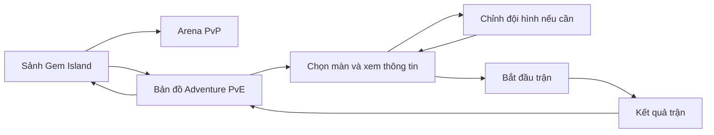

# Kế hoạch UI sảnh và bản đồ PvE

Ngày: 09/11/2026. Trạng thái: đề xuất thiết kế; chưa triển khai UI hoặc gameplay.

## 1. Hướng thiết kế

Giữ sảnh Gem Island hiện tại làm nơi chọn chế độ. Adventure PvE mở một màn bản đồ tiến trình riêng, nơi người chơi nhìn thấy đường đi, các màn đã thắng, màn tiếp theo và boss cuối. Arena PvP là lối vào riêng ngay tại sảnh.

Hiểu “map kiểu hyper casual” trong yêu cầu là cách chọn màn trực quan bằng các điểm trên đường đi uốn lượn, thao tác đơn giản và thấy rõ tiến trình. Gameplay chiến đấu vẫn theo thiết kế Match-3 RPG của Gemora.

Phân biệt thuật ngữ: bản đồ là khu vực/chương chứa nhiều màn; mỗi nút trên bản đồ là một màn chiến đấu. Bản đầu đề xuất một khu vực chứa 8 màn, phù hợp phạm vi GDD. Chưa cần thêm tầng chọn World rồi Chapter trước khi vào bản đồ.

## 2. Căn cứ hiện tại

- Preview sảnh đã có Adventure PvE, Arena PvP, đảo pha lê, rồng nhỏ và thanh Home/Team/Heroes/Inventory/Guide.
- Các nút chế độ hiện mở thông báo, chưa có màn bản đồ chọn ải.
- Dùng tiếp phong cách fantasy dễ thương: cây xanh, pha lê tím, nền kem, viền nâu vàng và góc bo tròn.
- Giữ nhãn giao diện tiếng Anh để thống nhất UI hiện có; tài liệu diễn giải bằng tiếng Việt.
- GDD quy định 8 stage, đội 3 hero, elite ở chặng 7 và boss ở chặng 8; không có stamina. Đánh giá sao còn tùy chọn, nên bản UI đầu chỉ thể hiện đã hoàn thành.
- PvP chưa nằm trong gameplay MVP. Thiết kế vị trí vào PvP ngay bây giờ; khi chưa có chức năng thật phải ghi Coming soon.

## 3. Luồng người dùng



Nhánh Arena hiện mở thông báo Coming soon. Luồng phòng đấu, ghép trận và xếp hạng sẽ được đặc tả khi có luật PvP.

Khi quay lại bản đồ từ trận hoặc đội hình, giữ màn đang chọn và vị trí cuộn. Lần đầu mở bản đồ tự đưa màn kế tiếp vào vùng nhìn thấy; không tự mở bảng chi tiết che toàn bộ bản đồ. Nếu có trận đang dở, hiện Resume battle và ngăn tạo thêm trận theo giới hạn một trận ACTIVE trong GDD.

## 4. UI sảnh

Giữ bố cục và cảnh đảo hiện có, thay nội dung thẻ chế độ theo tiến trình:

| Thành phần | Nội dung và hành vi |
| --- | --- |
| Adventure PvE | Thẻ lớn, ảnh vùng đang chơi, tên vùng, tiến trình như 3/8 stages, nút Open map |
| Arena PvP | Thẻ riêng dễ thấy ngay cùng cụm chọn chế độ; biểu tượng hai kiếm, nhãn PvP rõ ràng |
| Arena chưa mở | Coming soon; bấm để xem thông báo ngắn, không hiển thị rank hoặc ghép trận giả |
| Trận đang dở | Resume battle nổi bật trong thẻ PvE; vẫn có lối Open map phụ |
| Thanh chức năng | Giữ hệ thống hiện tại; không thêm nút Campaign trùng lặp trên sảnh |

Trên điện thoại, đặt cụm chọn chế độ ở vùng đầu nội dung, dưới thông tin người chơi; không để hình rồng hoặc cảnh trang trí đẩy cả hai chế độ xuống ngoài màn hình đầu.

## 5. Màn bản đồ PvE

### Bố cục desktop

- Thanh trên: Back to home, Adventure, tên khu vực và số màn hoàn thành.
- Bản đồ chiếm khoảng 2/3 chiều rộng; bên phải dành khoảng 320–360 px cho thông tin màn đang chọn.
- Đường đi hướng từ dưới lên, uốn nhẹ qua các cụm cây, suối, cầu và pha lê. Đường nối phải dễ lần theo và không tự cắt nhau.
- Cảnh nền dùng màu dịu hơn sảnh để nút màn và đường đi nổi bật. Chữ nằm trên bảng màu đặc, không đặt trực tiếp trên cây hoặc nước.
- Nút Current stage đưa về màn tiếp theo nếu người chơi đã cuộn ra xa.
- Chưa chọn màn: bảng bên phải giới thiệu khu vực và nút Find next stage; không bắt đầu trận ngay.

```text
┌──────────────────────────────────────────────────────────────────┐
│ ‹ Home      ADVENTURE · Whispering Woods          3/8 completed   │
├───────────────────────────────────────┬──────────────────────────┤
│              [8 · BOSS 🔒]             │ STAGE 1–4                │
│                    ╲                  │ Tên màn                  │
│               [7 · ELITE 🔒]           │ Mục tiêu                 │
│             ╱                         │                          │
│        [6 🔒]────[5 🔒]                │ Địch và nguyên tố        │
│                      ╲                │ Phần thưởng              │
│                  [4 ▶]                │ Thưởng lần đầu           │
│                 ╱                     │                          │
│       [2 ✓]──[3 ✓]                    │ Đội: [A] [B] [C]         │
│        ╲                              │ Edit team                │
│        [1 ✓]                          │                          │
│                      [Current stage]  │       [ PLAY ]           │
└───────────────────────────────────────┴──────────────────────────┘
```

Whispering Woods và tiến trình 3/8 chỉ minh họa bố cục, không phải dữ liệu thật hoặc nội dung đã chốt. Có thể cần cuộn để xem hết bản đồ; không thu nhỏ mọi nút chỉ để ép đủ 8 màn vào một khung.

### Bố cục mobile

- Thanh trên cố định gọn: nút về sảnh, tên vùng, tiến trình.
- Bản đồ chiếm toàn chiều rộng, cuộn dọc bằng một ngón; không cần kéo ngang, zoom hoặc xoay màn hình.
- Mỗi khung nhìn khoảng 3–4 nút màn, tùy chiều cao máy. Nút chạm tối thiểu 48 × 48 px, có khoảng trống giữa các nút.
- Chạm một màn mở bảng thông tin từ dưới lên, khoảng 55–65% chiều cao; phần nội dung cuộn được và nút Play luôn dễ tiếp cận.
- Đóng bằng nút X hoặc Back; sau đóng trở về đúng vị trí bản đồ và nút vừa chọn.
- Màn bản đồ dùng điều hướng gọn thay cho thanh 5 mục của sảnh; Edit team nằm trong thông tin màn. Giữ đủ khoảng trống theo vùng an toàn của thiết bị.

### Trạng thái nút màn

| Trạng thái | Hình thức | Khi chọn |
| --- | --- | --- |
| Đã thắng | Nút xanh, dấu ✓, số màn rõ | Xem thông tin, nút Replay |
| Đã mở, chưa thắng | Nút kem/vàng, số màn rõ | Xem thông tin, nút Play |
| Màn kế tiếp | Như màn đã mở, thêm vòng sáng nhẹ và nhãn Next | Điểm ưu tiên khi mở bản đồ |
| Đang được chọn | Viền đậm và dấu chọn riêng | Bảng thông tin khớp với màn đã chọn |
| Chưa mở | Nút xám tím và biểu tượng khóa | Hiện điều kiện, ví dụ Clear stage 1–4 to unlock; không có nút Play khả dụng |
| Elite / boss | Biểu tượng riêng và nhãn Elite / Boss | Vẫn dùng các trạng thái mở/khóa/đã thắng bên trên |

Trạng thái đang chọn và loại elite/boss là lớp bổ sung, không thay thế trạng thái tiến trình. Không phân biệt chỉ bằng màu. Chưa thêm 3 sao, rương mốc, thanh năng lượng hay khóa trả tiền khi chưa có thiết kế tương ứng.

## 6. Bảng thông tin màn

Thứ tự từ trên xuống:

1. Số màn, tên, loại Normal/Elite/Boss và mô tả mục tiêu một câu.
2. Chân dung địch, nguyên tố và một lưu ý cơ chế ngắn nếu có; biểu tượng có tên giải thích.
3. Phần thưởng thông thường và thưởng lần đầu tách rõ; đã nhận thưởng lần đầu thì ghi Claimed.
4. Ba ô hero của đội hiện tại và Edit team. Đội chưa đủ 3 hero hiện lý do và hành động hoàn thiện đội, không chỉ làm mờ Play.
5. Nút Play / Replay / Resume battle theo trạng thái hợp lệ.

Chỉ hiện chỉ số độ khó hoặc sức mạnh khuyến nghị nếu có dữ liệu và quy tắc thật. Không dùng con số tự đặt khiến người chơi hiểu đó là yêu cầu bắt buộc.

Khi bắt đầu trận: đổi nhãn thành Starting…, chặn gửi lặp; chỉ chuyển màn sau khi server xác nhận. Nếu lỗi, giữ màn và đội đã chọn, giải thích ngắn và cho thử lại.

## 7. Trở lại bản đồ sau trận

- Thắng: trang kết quả có Next stage và Back to map. Next stage mở thông tin màn kế tiếp để người chơi xem/đổi đội trước khi đánh.
- Bản đồ cập nhật dấu hoàn thành và mở nút kế tiếp sau xác nhận server; chạy hiệu ứng ngắn trên đường nối. Khi giảm chuyển động, cập nhật tức thì.
- Thua: Retry, Edit team và Back to map; không đánh dấu mở màn kế tiếp.
- Thắng boss cuối: hiện Chapter complete và cho chơi lại. Chỉ hiện khu vực tiếp theo khi có nội dung thật; không đặt nút dẫn tới trang trống.
- Phần thưởng kết quả chỉ hiện sau xác nhận cấp thưởng; không cộng từ hiệu ứng hoặc dữ liệu preview.

## 8. Trạng thái hệ thống và khả năng sử dụng

- Đang tải: khung bản đồ và bảng thông tin có trạng thái loading ổn định; không chớp lên tiến trình mẫu.
- Tải lỗi: thông báo và Retry tại màn bản đồ, luôn có đường về sảnh.
- Chưa có nội dung: thông báo Adventure is coming soon; không vẽ các màn giả như có thể chơi.
- Lỗi lấy chi tiết màn: giữ bản đồ, cho thử lại trong bảng thông tin.
- Tiến trình đổi hoặc màn bị khóa khi bắt đầu: cập nhật từ server, giữ ngữ cảnh và hiện lý do.
- Bàn phím: Tab đến các màn theo thứ tự số; Enter/Space mở; Escape đóng bảng nổi và trả focus. Nút khóa vẫn có thể xem lý do.
- Đọc màn hình: tên như Stage 1–4, unlocked, next stage; đường nối/cây/đá là trang trí.
- Tôn trọng giảm chuyển động; không dùng nhấp nháy liên tục. Đảm bảo chữ và trạng thái rõ trên nền.

## 9. Kế hoạch thực hiện

| Bước | Sản phẩm bàn giao | Điều kiện xong |
| --- | --- | --- |
| 1. Wireframe | Sảnh cập nhật, bản đồ desktop/mobile, bảng thông tin và trạng thái khóa | Nhìn rõ hai chế độ, màn tiếp theo và cách bắt đầu |
| 2. Thiết kế hình ảnh | Nền vùng đầu, bộ nút Normal/Elite/Boss, bảng thông tin đồng bộ sảnh | Nút màn nổi bật, chữ dễ đọc, không lấn trên mobile |
| 3. Prototype tương tác | Bấm PvE, cuộn bản đồ, chọn màn, đóng/mở thông tin, về sảnh | Có đủ 8 màn mẫu và trạng thái mô phỏng được ghi rõ là preview |
| 4. Tích hợp dữ liệu | Tiến trình, thông tin màn, đội hình, bắt đầu/tiếp tục trận | Giữ đúng dữ liệu theo tài khoản; không dùng dữ liệu mẫu trên bản thật |
| 5. Kiểm tra và bàn giao | Ảnh desktop/mobile, rà soát thao tác và trạng thái lỗi | Đạt tiêu chí bên dưới |

Phần UI có thể làm trước với dữ liệu mẫu trong preview. Bắt đầu trận, đội hình và tiến trình thật phụ thuộc các API gameplay; không coi prototype là hoàn tất gameplay.

Định hướng triển khai: HTML/CSS cho bố cục và nút; SVG cho đường nối trang trí; nền minh họa là asset riêng. Đặt node theo tọa độ tương đối trong một vùng bản đồ có chiều cao tối thiểu để đường và nút không lệch khi thay đổi kích thước. Chưa cần PixiJS cho màn chọn ải.

Tách thành màn Campaign và các thành phần Map, Stage node, Stage details để preview và bản thật dùng chung. Đường dẫn dự kiến `/campaign`, tuân theo điều phối phiên/onboarding hiện có. Dữ liệu cần có ID/thứ tự màn, vị trí trên map, loại màn, điều kiện mở, trạng thái hoàn thành, địch, thưởng và đội hiện tại. Server quyết định quyền vào màn và kết quả; vị trí bản đồ chỉ phục vụ trình bày.

## 10. Tiêu chí nghiệm thu UI

1. Từ sảnh, một lần bấm PvE đến bản đồ; Arena vẫn nhận ra được là chế độ riêng.
2. Người mới nhận biết được màn cần chơi tiếp, trạng thái khóa và boss cuối mà không cần hướng dẫn dài.
3. Từ bản đồ, chọn màn rồi Play là đủ để bắt đầu khi đội hợp lệ; không thêm màn trung gian không cần thiết.
4. Mọi màn đã mở có thể được chọn; màn đã thắng có Replay, màn khóa giải thích được điều kiện.
5. Quay về từ đội hình hoặc trận giữ đúng màn đang chọn và vị trí cuộn.
6. Kiểm tra ở chiều rộng 360, 390, 768 và 1440 px; không tràn ngang, che nút hoặc chồng nhãn.
7. Điều khiển bằng bàn phím và trạng thái giảm chuyển động hoạt động; không truyền đạt tiến trình chỉ bằng màu.
8. Không hiển thị số dư, phần thưởng đã nhận, cấp hoặc tiến trình mẫu như dữ liệu thật.
9. Có thiết kế rõ cho loading, lỗi, chưa có nội dung và trận đang dở.

Phạm vi đợt UI này: cập nhật lối vào hai chế độ ở sảnh, bản đồ PvE, bảng chọn màn và hành vi quay lại. Thiết kế phòng đấu PvP và UI chiến đấu thuộc đợt riêng.
