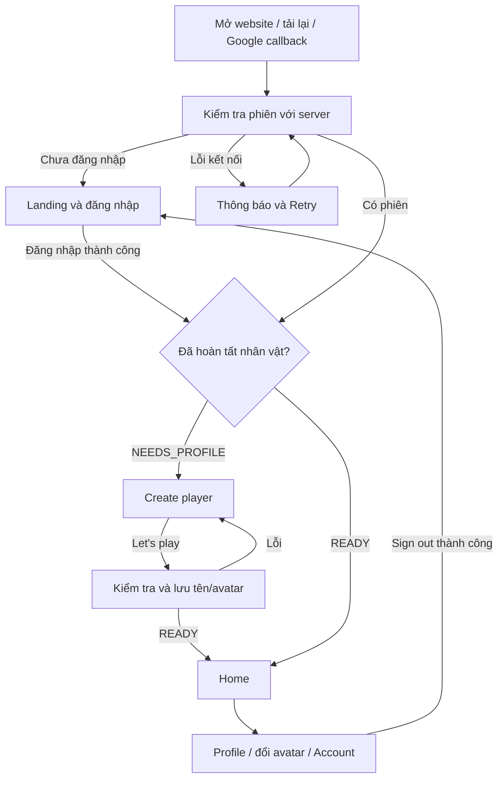

# Kế hoạch nối UI tạo nhân vật và sảnh vào luồng thật

> Triển khai 09/11/2026: đã nối API onboarding/home/avatar với auth và UI. Đăng ký không hỏi tên; email/Google/restore phân luồng bằng trạng thái server. Giao diện preview và bản thật dùng chung renderer hiện có trong `preview/player-preview.ts` qua callback, bộ điều phối nằm trong `main.ts` để tái sử dụng auth; chưa tách thành các file router/screens riêng như đề xuất bên dưới. Build client/server đạt; 23 test auth/player/Google, 27 test database và 19 test trình duyệt đạt, có luồng browser → API → database kiểm thử thật. Google thật vẫn cần kiểm chứng tương tác với cấu hình tài khoản Google. Phần bên dưới giữ làm đặc tả/tham chiếu; gameplay vẫn chưa triển khai.

Ngày lập: 08/11/2026. Cập nhật: 09/11/2026 sau khi kiểm tra lại code. Trạng thái: database đã bổ sung; API nhân vật và luồng UI bên dưới còn là kế hoạch. Đợt cập nhật tài liệu này không thay đổi mã ứng dụng hoặc database.

**Tiến độ sau lập kế hoạch:** ngày 08/11/2026 đã áp dụng migration bổ sung `PlayerProfile` vào `gemora_dev`, gồm `playerName`, `normalizedPlayerName`, `avatarKey`, `onboardingCompletedAt`, unique tên và CHECK tính nhất quán. Mốc 1 mới hoàn tất phần database; hợp đồng/API và các mốc UI còn chưa triển khai.

Tài liệu này cập nhật bước triển khai tiếp theo của `PLAYER_ONBOARDING_LOBBY_PLAN.md`. Giao diện đã duyệt là chuẩn: tiếng Anh, nền đảo cartoon, thú chào người chơi, form gọn, avatar tròn tùy chọn và nút “Let's play” dạng pill. Không quay lại các mô tả UI cũ trong kế hoạch trước.

## 1. Hiện trạng đã xác minh

| Phần | Hiện có | Khoảng trống cần nối |
| --- | --- | --- |
| `src/bootstrap.ts` | `?preview=create-player` và `?preview=home` mở UI độc lập | Luồng thực tế vẫn tải `main.ts` |
| `src/main.ts` | Đăng ký/email login, Google callback, khôi phục phiên, liên kết Google, logout | Sau login vẫn render landing; nhiều callback gọi `renderLanding()` trực tiếp |
| `src/preview/player-preview.ts` | Form, avatar picker, sảnh và lời chào hoàn chỉnh về mặt hình ảnh | Tên/avatar chỉ nằm trong bộ nhớ; đổi màn bằng query preview; sảnh có dữ liệu minh họa |
| Backend auth | Cookie phiên, `/auth/me`, đăng ký/email/Google | Chưa có trạng thái hoàn tất nhân vật hoặc API lưu tên/avatar |
| `PlayerProfile` | Một profile/tài khoản; đã có tên nhân vật, khóa tên unique, avatar và timestamp hoàn tất với các CHECK | Auth chưa trả trạng thái này; chưa có API ghi bốn trường mới |
| Gameplay | Chưa có API campaign/battle/economy; `game-core/src/index.ts` hiện rỗng | Các nút PvE/PvP chưa thể dẫn vào trận thật |

Giữ Vite + TypeScript + HTML/CSS cho hai màn. Tiếp tục dùng NestJS/Prisma/PostgreSQL và cookie phiên hiện có, không thêm framework hay dependency cho việc điều hướng này.

## 2. Luồng mục tiêu

- `/`: khách thấy landing; người có phiên đến màn phù hợp.
- `/create-player`: chỉ dành cho người có phiên nhưng chưa hoàn tất nhân vật.
- `/home`: chỉ dành cho người có phiên và đã hoàn tất nhân vật.
- Email login, Google callback, restore session và quay lại tab dùng chung một hàm quyết định màn. Không tin riêng tham số `auth=success`.
- Đăng ký email vẫn tạo tài khoản rồi yêu cầu đăng nhập như hiện tại; bỏ ô Display name để tên game chỉ được hỏi một lần ở Create player.
- Dùng `replaceState` khi chuyển qua bước xác thực/tạo nhân vật; xử lý `popstate` và đường dẫn truy cập trực tiếp theo cùng quy tắc.
- Lỗi mạng/5xx giữ trạng thái lỗi có Retry, không suy diễn là tài khoản mới. 401 đưa về đăng nhập và xóa dữ liệu người trước khỏi UI.

## 3. Dữ liệu và hợp đồng tối thiểu

Phần mở rộng `PlayerProfile` sau đây đã triển khai; giữ ID và `displayName` cũ để tương thích. Đợt API/UI tiếp theo dùng schema này, không cần migration mới:

| Trường mới | Ý nghĩa |
| --- | --- |
| `playerName` nullable | Tên nhân vật do người chơi xác nhận |
| `normalizedPlayerName` nullable, unique | Khóa kiểm tra trùng tên |
| `avatarKey` nullable | ID ổn định: `crystal-dragon`, `moon`, `sun`, `leaf`, `crystal` |
| `onboardingCompletedAt` nullable | Thời điểm hoàn tất |

`AuthUser` thêm `onboardingState: NEEDS_PROFILE | READY` và thông tin nhân vật. Server suy ra READY khi đầy đủ các trường trên; không lưu thêm boolean độc lập. Ràng buộc database giữ trạng thái nhất quán. Không dùng thứ tự avatar trong mảng hoặc `key: gem` hiện bị dùng chung cho hai avatar làm ID lưu trữ.

Đề xuất tên: 3–16 Unicode code point, NFC, trim/gộp khoảng trắng, chữ/số/underscore và khoảng trắng giữa từ; dấu kết hợp chỉ gắn với chữ. Tên duy nhất, không phân biệt hoa/thường, có phân biệt dấu. Server quyết định cuối cùng, client chỉ kiểm tra sớm. Avatar mặc định là `crystal-dragon`, không bắt người chơi mở picker.

Tài khoản hiện có chưa từng qua bước xác nhận nhân vật: đề xuất xác nhận tên một lần. Giữ nguyên tài khoản, session và profile ID; không tự biến tên Google thành tên công khai. Sau lần này, đăng nhập lại vào thẳng Home. Tên đã được xác nhận ở một hệ thống khác chỉ được backfill nếu có dữ liệu chứng minh, không đoán từ `displayName`.

API dự kiến, cùng tiền tố `/api/v1`:

| API | Kết quả |
| --- | --- |
| `GET /auth/me`, response `POST /auth/login` | Trạng thái onboarding và danh tính nhân vật |
| `POST /players/me/onboarding` với `{ playerName, avatarKey }` | Lưu một lần, trả hồ sơ và trạng thái READY |
| `GET /players/me/home` | Tên/avatar thật và trạng thái mở của tính năng |
| `POST /players/me/avatar` với `{ avatarKey }` | Đổi avatar sau này, trả hồ sơ đã lưu |

Đợt đầu kiểm tra tên khi nhấn “Let's play”; chưa cần thêm API kiểm tra tên liên tục. Đây là phần rút gọn so với kế hoạch cũ để giữ UI gọn. Gợi ý tên không đồng nghĩa tên đã được giữ chỗ.

Server dùng phiên để xác định người sở hữu, không nhận userId từ form. Tái sử dụng SessionGuard và bảo vệ Origin/JSON/no-store/rate limit hiện có. Việc ghi tên chạy trong transaction, unique index xử lý tranh tên; hai tab không được ghi đè nhân vật đã hoàn tất. Gửi lại cùng dữ liệu trả kết quả hiện có; dữ liệu khác sau hoàn tất trả lỗi trạng thái. Mất phản hồi sau lưu: kiểm tra lại `/auth/me` trước khi cho gửi tiếp.

Bổ sung mã lỗi ổn định vào hợp đồng lỗi và `ApiErrorFilter`, ví dụ `PLAYER_NAME_TAKEN`, `INVALID_PLAYER_NAME`, `INVALID_AVATAR`, `PROFILE_ALREADY_COMPLETED`, `PROFILE_REQUIRED`. Client ánh xạ sang thông báo tiếng Anh, không suy luận loại lỗi từ câu chữ.

## 4. Tách UI để tái sử dụng

- Chuyển phần render form và home từ preview sang `src/screens/create-player.ts` và `src/screens/home.ts`; nhận dữ liệu/callback thay vì tự gọi URL preview.
- Dùng chung avatar catalog, portrait, icon, dialog và các CSS đã duyệt. Bổ sung hàm hủy màn để gỡ listener, dialog, `inert` và lớp body khi chuyển về auth.
- Preview chỉ còn lớp cung cấp dữ liệu mẫu cho chính các màn này; giữ truy cập trong môi trường phát triển. Bản thật không có thanh “UI PREVIEW”, nút đổi màn demo hoặc footer “Changes aren't saved”.
- Tạo `src/app/router.ts` và bộ điều phối trạng thái để `main.ts` không còn tự render landing trong mọi callback. Đặc biệt, kết quả tải Google providers hoặc refresh session đến muộn không được ghi đè Home hay xóa form đang nhập.
- Mọi request gắn với phiên/tài khoản hiện hành; bỏ kết quả cũ sau logout hoặc đổi tài khoản. Chuyển focus vào tiêu đề màn mới, giữ focus trap và phục hồi focus của dialog.
- Khi gửi form: khóa gửi lặp, `aria-busy`, nhãn “Creating…”. Lỗi giữ tên/avatar và cho sửa; chỉ vào Home khi server xác nhận READY.
- Đổi avatar trong Create player chỉ đổi bản nháp; ở Home gọi API lưu thật. Nếu lưu thất bại giữ avatar đã lưu và hiển thị Retry.
- Di chuyển thao tác liên kết Google và logout từ landing vào Account thật; cho phép đổi tài khoản từ màn tạo nhân vật qua hành động nhỏ ngoài form.
- Giữ lời chào “Welcome to Gemora!” ở Create player; sau tạo thành công dùng “Welcome, {name}!”, các lần vào lại dùng “Welcome back, {name}!”. Escape tên trước khi render.

Home chỉ hiển thị tên/avatar có dữ liệu thật. Gold 1,250, Lv. 01, XP 0/100 và nhiệm vụ 1–1 hiện là mẫu: ẩn ở bản thật cho đến khi có hệ thống tương ứng. Giữ vị trí Adventure/Arena/Team/Heroes/Inventory; mục chưa hoạt động ghi “Coming soon”, không thể bắt đầu trận hoặc nhận thưởng giả.

## 5. Thứ tự triển khai và bàn giao

| Mốc | Việc cần làm | Điều kiện hoàn thành |
| --- | --- | --- |
| 1. API trên schema đã có | Shared types, trạng thái onboarding, lưu tên và avatar, API home, lỗi có code | Dữ liệu lưu bền; xử lý trùng tên, gửi lặp và quyền sở hữu đúng |
| 2. UI dùng chung | Tách hai màn khỏi preview, giữ CSS và hình đã duyệt, thêm loading/error | Preview và bản thật dùng cùng UI, không lệch thiết kế |
| 3. Điều hướng thật | Nối email/Google/restore vào router; bỏ tên ở đăng ký; xử lý refresh, Back, logout | Người mới đến Create player; người đã READY đến Home |
| 4. Sảnh với dữ liệu thật | Nối hồ sơ/đổi avatar/Account; bỏ dữ liệu mẫu, đánh dấu chức năng chưa mở | Tải lại vẫn đúng tên/avatar; Google link và logout hoạt động |
| 5. Kiểm chứng | Test tích hợp/backend, browser, desktop/mobile; chụp UI; cập nhật hướng dẫn | Toàn bộ tiêu chí dưới đây đạt |

Các nhóm file dự kiến:

- Client: `bootstrap.ts`, `main.ts`, `auth/session.ts`, `api/http.ts`; mới `app/router.ts`, `api/players.ts`, `screens/`, các thành phần UI dùng chung; thu gọn `preview/player-preview.ts`.
- Server: dùng schema/migration hiện có; sửa `auth.service.ts`, validation đăng ký, exports của `auth.module.ts`, `app.module.ts`, `api-error.filter.ts`; mới module `players/`.
- Hợp đồng: `packages/shared-types/src/auth.d.ts`, thêm hợp đồng player và cập nhật exports theo cấu trúc package hiện có.
- Kiểm thử: cập nhật test auth vốn đang chờ landing sau login, thêm test onboarding/avatar và nối màn; giữ script chụp preview.

Rollout: xác nhận môi trường đích đã áp dụng migration onboarding → backend hỗ trợ hợp đồng mới và tạm nhận đăng ký kiểu cũ → client dùng luồng mới. Không reset hoặc chạy lại thiết kế database. Kiểm tra cấu hình SPA phục vụ `/home` và `/create-player` khi tải lại, đồng thời giữ `/api` riêng. Không cần thay OAuth callback hiện tại.

## 6. Tiêu chí nghiệm thu

1. Email mới và Google mới vào Create player sau khi xác nhận phiên; tài khoản READY vào Home.
2. Tên/avatar còn nguyên sau tải lại, logout/login và mở bằng phiên trình duyệt khác.
3. Thoát giữa bước tạo tên không làm mất tài khoản hoặc bị đánh dấu đã hoàn tất.
4. Truy cập trực tiếp URL, Back/Forward và quay lại tab đều mở đúng màn; không lóe dữ liệu tài khoản trước.
5. Tên sai/trùng, hai tài khoản tranh tên và hai tab cùng tạo đều được xử lý đúng ở server.
6. Mất phản hồi sau commit khôi phục được hồ sơ; không tạo thêm hoặc ghi đè nhân vật.
7. Disabled ngăn gửi lặp, lỗi mạng có Retry; Tab/Enter/Space và focus hoạt động; UI mobile không tràn ngang.
8. Avatar đổi từ Home lưu thật; liên kết Google giữ nguyên nhân vật; logout xóa dữ liệu khỏi màn.
9. Không hiện số dư/cấp/nhiệm vụ mẫu như dữ liệu thật; PvE/PvP chưa có backend được ghi rõ chưa mở.
10. Test auth/database hiện có đạt sau cập nhật hợp đồng; bổ sung test API mới bằng database kiểm thử riêng. Google thật cần kiểm tra tương tác với cấu hình hiện hành ngoài các test giả lập.

Phạm vi hoàn thành của đợt này là **đăng nhập → tạo nhân vật một lần → sảnh có dữ liệu thật**, chưa bao gồm trận PvE/PvP, hero, inventory hay economy. Các hệ thống đó nối tiếp vào các điểm vào sẵn có trên Home.

## 7. Kế hoạch thực thi API và điều hướng — 09/11/2026

### P1. Hợp đồng dữ liệu và API

Chốt một kiểu `PlayerIdentity` trả ra ngoài: `{ id, playerName, avatarKey, onboardingCompletedAt }`. Thời gian là chuỗi ISO; không trả normalizedPlayerName, token hash hay entity database nguyên bản.

`AuthUser` bổ sung cặp trạng thái có kiểu rõ:

- `onboardingState: "NEEDS_PROFILE"`, `player: null`.
- `onboardingState: "READY"`, `player: PlayerIdentity`.

Giữ `profile: { id, displayName } | null` cũ trong giai đoạn tương thích. `player` là nguồn duy nhất của tên/avatar hiển thị trên Home. Một hàm ánh xạ thuần dùng chung cho login, `/auth/me` và API onboarding; tránh hai nơi suy ra trạng thái khác nhau hoặc tạo vòng phụ thuộc AuthService ↔ PlayersService.

Package shared-types hiện trỏ trực tiếp `types` tới `src/auth.d.ts`. Khi thêm hợp đồng player cần tạo entry declaration xuất cả auth/player và cập nhật `types`; không chỉ thêm file rồi để client không import được. Giữ package chỉ chứa type, không thêm dependency runtime.

| Endpoint | Request | Response thành công | Điều kiện |
| --- | --- | --- | --- |
| `GET /auth/me` | Cookie phiên | 200 `{ user }` với trạng thái mới | Phiên hợp lệ |
| `POST /auth/login` | Email/password | 200 `{ user }` cùng cookie như hiện tại | Mật khẩu đúng |
| `POST /players/me/onboarding` | `{ playerName, avatarKey? }` | 200 `{ user }` READY, kể cả retry hợp lệ | Phiên hợp lệ; avatar bỏ trống dùng `crystal-dragon` |
| `GET /players/me/home` | Cookie phiên | 200 `{ player, features }` | READY |
| `POST /players/me/avatar` | `{ avatarKey }` | 200 `{ player }` | READY |

`features` trả trạng thái `coming_soon` cho Adventure/Arena/Team/Heroes/Inventory trong đợt này. Profile và Account có hành vi thật. Không trả Gold/level/XP/quest giả. Chưa cần thêm endpoint kiểm tra tên hoặc GET profile riêng vì `/auth/me` và home đã đủ.

Đăng ký email: `displayName` trở thành tùy chọn để client mới gửi email/password; payload cũ vẫn được validate nếu có tên. Dùng giá trị nội bộ trung tính `Adventurer` cho cột legacy bắt buộc khi thiếu, không dùng email làm tên công khai. Đăng ký vẫn không tạo session tự động. Client bỏ ô Display name, giữ bước đăng nhập hiện tại.

### P2. Ghi nhân vật nguyên tử và xử lý lỗi

Module mới `players/` gồm controller, service, validation và mapper. Nhập AuthModule để dùng cùng PrismaService/SessionGuard; export/tái sử dụng lớp bảo vệ Origin, JSON và giới hạn request hiện có, không tạo pool database thứ hai.

Trình tự xử lý onboarding:

1. Chỉ nhận playerName/avatarKey, từ chối trường thừa như userId/role/level. Giới hạn độ dài đầu vào trước chuẩn hóa; từ chối ký tự điều khiển/ẩn, không biến xuống dòng thành khoảng trắng hợp lệ.
2. NFC, trim và gộp dấu cách; đếm code point 3–16, cho phép chữ/số/underscore và dấu cách giữa từ, dấu kết hợp chỉ đi sau chữ. Danh sách tên hệ thống dành riêng ban đầu: `admin`, `administrator`, `moderator`, `system`, `support`, `gemora`, so theo khóa tên, không chặn theo substring. Server là nguồn quyết định.
3. Lấy userId từ phiên. Trong transaction, khóa phiên rồi khóa User theo thứ tự thống nhất; đọc lại hạn phiên/thu hồi/trạng thái tài khoản sau khi lấy khóa. Quyết định ghi phải được tuần tự hóa với logout/khóa tài khoản, không chỉ dựa vào SessionGuard chạy trước transaction.
4. Đọc profile sau khi khóa User. Nếu chưa có profile, tạo với displayName legacy trung tính; nếu có thì giữ ID. Khóa User tuần tự hóa cả trường hợp chưa có profile và nhiều phiên của cùng tài khoản.
5. Nếu đã READY: cùng tên chuẩn hóa và avatar đang lưu thì trả kết quả hiện có, không đổi timestamp. Nếu khác thì trả `PROFILE_ALREADY_COMPLETED`, không ghi đè tên hoặc đổi avatar qua endpoint này. Đổi avatar chỉ đi qua endpoint riêng.
6. Nếu chưa hoàn tất: tạo khóa tên bằng chính phép `lower(normalize(..., NFC) COLLATE "pg_catalog"."pg_c_utf8")` trong SQL tham số hóa; không tin khóa client gửi và không giả định mọi phiên bản JavaScript có bảng chuyển chữ thường giống database. Lưu cả bốn trường mới trong một thao tác thuộc transaction.
7. Unique index quyết định người thắng nếu hai tài khoản tranh tên. Bắt lỗi sau rollback, chỉ ánh xạ xung đột unique của khóa tên sang `PLAYER_NAME_TAKEN`. Lỗi constraint bất ngờ là lỗi server được ghi log, không trả chi tiết SQL cho UI.

Endpoint avatar áp dụng cùng kiểm tra phiên/quyền; chỉ cập nhật avatar của profile READY, giữ tên và timestamp hoàn tất. Một request đổi avatar tại một thời điểm trên client; nếu hai thiết bị cùng đổi, lần ghi được tuần tự hóa sau cùng có hiệu lực. Không tự retry request cũ vì có thể ghi đè lựa chọn mới.

| Mã lỗi | HTTP | Phản ứng của UI |
| --- | --- | --- |
| `INVALID_PLAYER_NAME`, `PLAYER_NAME_RESERVED` | 400 | Hiện lỗi dưới ô tên, giữ bản nháp |
| `INVALID_AVATAR` | 400 | Giữ form, báo chọn lại avatar |
| `PLAYER_NAME_TAKEN` | 409 | “This name is already taken.” và focus ô tên |
| `PROFILE_ALREADY_COMPLETED` | 409 | Đọc lại `/auth/me`, chuyển đúng nhân vật đã lưu |
| `PROFILE_REQUIRED` | 403 | Đọc lại phiên và về Create player |
| Phiên hết hạn/không hợp lệ | 401 | Xóa trạng thái tài khoản cũ, yêu cầu đăng nhập |
| Origin không hợp lệ | 403 | Báo request thất bại, không hiểu nhầm là cần tạo tên |
| Quá nhiều yêu cầu | 429 | Hiển thị chờ/thử lại theo Retry-After thực tế |
| Mất mạng/timeout/5xx | — | Đối soát trạng thái trước khi cho gửi lại |

Mở rộng `ApiErrorResponse`/`ApiError` thêm code tùy chọn và Retry-After khi có. `ApiErrorFilter` hiện chỉ trả message: cần giữ mã lỗi có cấu trúc cho lỗi dự kiến, vẫn giữ thông báo chung cho 5xx và tương thích lỗi auth cũ.

### P3. Điều phối màn dùng chung

Tạo `app/router.ts` và bộ điều phối ứng dụng với trạng thái khởi tạo/khách/đang tải nhân vật/tạo nhân vật/sảnh/lỗi kết nối. Không suy ra danh tính từ URL hoặc localStorage.

| Sự kiện | Hành vi |
| --- | --- |
| Mở `/`, `/home`, `/create-player` | Kiểm tra `/auth/me` trước khi quyết định màn |
| Email login thành công | Dùng response đã xác thực để phân luồng; không cần gọi `/me` lặp ngay |
| Google quay về `/?auth=...` | Xác nhận qua `/me`, xóa query thông báo, phân luồng như email |
| READY nhưng API home lỗi | Giữ thông tin đã biết, hiển thị Retry tải sảnh; không bắt tạo tên lại |
| Tab được focus lại | Đối soát phiên, chỉ chuyển màn nếu user/trạng thái thực sự đổi |
| Logout thành công hoặc API trả 401 | Hủy/bỏ kết quả request cũ, gỡ dialog, xóa dữ liệu tài khoản, về landing |
| Logout mất response | Đọc lại `/me`; guest thì hoàn tất logout, còn phiên thì cho thử lại; chưa xác nhận được thì báo lỗi |
| Back/Forward và link logo | Đi qua router và guard tương tự; logo bản thật không còn URL preview |

Thay các lời gọi `renderLanding()` vô điều kiện trong `handleSubmit`, `handleLink`, `signOut`, `refreshSession`, `loadProviders` và Google callback bằng cập nhật trạng thái ứng dụng. Việc tải danh sách Google providers chỉ cập nhật vùng đăng nhập/Account cần thiết, không dựng lại màn game.

Quản lý request theo thế hệ phiên và phiên bản thao tác: kết quả từ tài khoản cũ hoặc trước lần lưu mới không được ghi đè trạng thái mới. Kiểm tra phiên cùng người dùng không được reset form, picker, focus hoặc nội dung đã nhập. Khi chuyển màn phải gỡ listener/dialog và reset `inert`/body class; khi lỗi kết nối chỉ giữ bản nháp trong bộ nhớ cùng phiên, không lưu token hay mật khẩu trong storage.

### P4. Nối UI đã duyệt

- Tách `create-player.ts`, `home.ts`, avatar catalog và dialog dùng chung từ preview. CSS/style/asset giữ nguyên; chỉnh chiều cao màn thật để bỏ phần trừ chiều cao thanh preview hiện có.
- Create player có các trạng thái `editing → saving → reconciling/error/success`. Khi saving khóa submit và các thao tác sửa bản nháp, hiển thị “Creating…” và aria-busy. Lỗi giữ tên/avatar; success mới vào Home.
- Timeout/5xx sau submit: giữ payload vừa gửi, kiểm tra `/auth/me`. READY thì vào Home; NEEDS_PROFILE thì cho thử lại; không đọc được trạng thái thì nút Retry kiểm tra kết nối trước, không gửi POST liên tục.
- Home dùng `player` thật, avatar picker lưu qua API. Lỗi đổi avatar giữ avatar đã xác nhận; nếu mất response thì đọc lại hồ sơ trước khi báo kết quả.
- Account trên Home giữ liên kết Google/đăng xuất; Create player có đường đổi tài khoản nhỏ ngoài form. Account link callback trở lại đúng màn theo trạng thái nhân vật.
- Preview trở thành dữ liệu mẫu cho cùng các component, chỉ bật ở môi trường phát triển. Bản thật không có thanh chuyển màn demo/footer preview.
- Giữ nguyên tiếng Anh, lời chào thú, khung kem/nâu, avatar tròn và nút pill. Ẩn số liệu chưa có hệ thống; các tính năng chưa mở có phản hồi “Coming soon”.

### P5. Kiểm tra và bàn giao

Không chạy test ghi trên `gemora_dev`. Dùng database `_test` đã áp dụng cả ba migration hiện có.

| Nhóm | Tình huống bắt buộc |
| --- | --- |
| API thực | Tạo nhân vật từ email/Google, avatar mặc định, tên tiếng Việt/NFC, Unicode chuyển hoa/thường, tên dành riêng, đầu vào thừa |
| Tranh chấp | Hai tài khoản cùng tên; hai phiên cùng tài khoản gửi cùng/khác payload; logout và lưu đồng thời; kết quả duy nhất, không ghi đè |
| Retry | Response mất sau commit, gửi lại không đổi profile ID/timestamp, không tạo nhân vật thứ hai |
| Quyền | Không phiên, phiên bị thu hồi/hết hạn, account bị khóa, Origin sai, avatar/home khi chưa READY |
| UI | Login người mới/cũ; reload deep link; Google callback; providers về chậm; refresh phiên không mất tên; response cũ sau đổi tài khoản |
| Tài khoản | Đăng ký mới không hỏi tên hai lần; đăng ký cũ còn tương thích; link Google giữ nhân vật; logout hoạt động từ Home |
| Avatar | Thay đổi rồi reload/login vẫn giữ; lỗi/mất mạng có thể khôi phục lựa chọn server |
| Hình ảnh | Desktop/mobile, bàn phím mềm, Tab/Enter/Space, focus dialog, reduced motion; chụp hai màn để so với bản đã duyệt |

Cập nhật test auth trình duyệt hiện đang chờ landing sau login và fixture chỉ có displayName. Giữ test auth/database cũ; thêm test API player, test điều hướng bằng response điều khiển được và ít nhất một luồng browser → API → database thật trên môi trường test. Google thực tế vẫn cần kiểm chứng tương tác với cấu hình Google hiện hành ngoài bộ test giả lập.

Thứ tự bàn giao: **P1 hợp đồng → P2 API và test → P3 điều phối + P4 UI → P5 kiểm chứng toàn luồng**. Không thêm gameplay hoặc dependency mới trong đợt này. Sau hoàn thành, cập nhật AUTH_SETUP và đánh dấu từng mốc bằng kết quả đã chạy thực tế.
